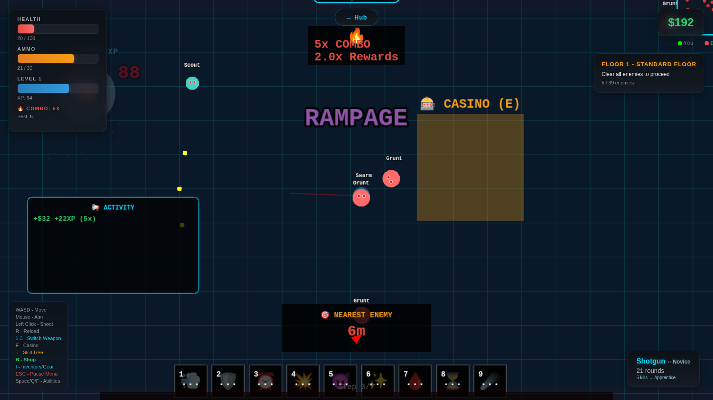
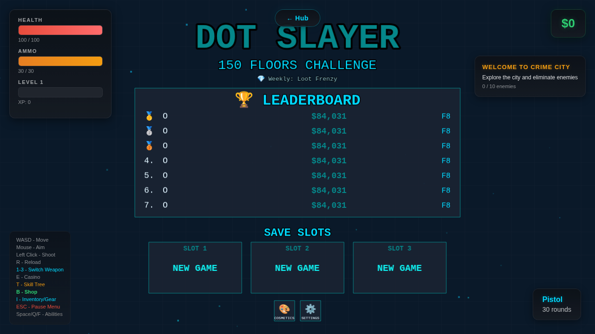

# Dot Universe

Two browser games that share one account and feed into each other: **DotSlayer**, a top-down roguelike shooter with 150 procedurally generated floors, and **Dot Clicker**, an idle/incremental game. Built with Next.js, Phaser 3 and Supabase, deployed on Vercel.

[](https://www.dotslayer.live)




---

## Features

### DotSlayer: roguelike shooter
- **150 procedurally generated floors** with themed environments, floor modifiers, elite and treasure floors, and a boss every 10th floor
- **6 player classes** (Soldier, Gunslinger, Tank, Assassin, Berserker, Vampire), each with its own starting weapon and stat profile
- Skill tree, shop, inventory with item sets, weapon mastery, crafting and companions
- Prestige / NG+ meta-progression with a talent tree
- Endless mode and unlockable challenge modes (Boss Rush, Survival, Speed Run, Hardcore)
- Daily and weekly challenges, a rotating weekly modifier, and achievements
- **3 cloud save slots** per account and a **global leaderboard**

### Dot Clicker: idle / incremental
- Buildings, upgrades, prestige and ascension layers
- Offline progress
- Cloud-synced saves

### Platform
- Hub page, player profiles, news page
- Google OAuth and email/password sign-in
- SEO metadata, JSON-LD structured data, sitemap, generated Open Graph images, PWA manifest



---

## Architecture

```
Next.js App Router (React)            Phaser 3 (client-only)
 ├─ app/page.tsx      landing          lib/game/GameWrapper.tsx  mounts the Phaser.Game
 ├─ app/slayer/       DotSlayer page   lib/game/MenuScene.ts     start menu, saves, leaderboard
 ├─ app/clicker/      Dot Clicker      lib/game/GameSceneV3.ts   main gameplay scene
 ├─ app/hub, profile, news, login      lib/game/*System.ts       gameplay systems (singletons)
 └─ app/auth/callback OAuth code exchange
                │
                ▼
        lib/supabase/*  ── Supabase (Postgres + Auth, row-level security)
```

- **React / Phaser bridge.** Phaser is loaded with `next/dynamic` (`ssr: false`) so it never runs on the server. React owns routing, auth and the HUD overlay; Phaser owns the canvas. The game emits events through `window.dispatchEvent(new CustomEvent('gameEvent', ...))` and the React page listens for them to update the HUD. The signed-in user is passed into Phaser via the game registry.
- **Auth.** Supabase Auth (Google OAuth plus email/password). `AuthContext` exposes the session to the app; `/auth/callback` exchanges the OAuth code for a session. Game pages require a signed-in user.
- **Cloud saves.** `SaveManager` stores DotSlayer runs in three slots per user (player state, floor, alive/dead flag); `ClickerSyncService` syncs Dot Clicker state. Tables are protected with row-level security so users can only read and write their own rows.
- **Leaderboards and stats.** `LeaderboardService` reads and writes the global score table; `SlayerStatsService`, `SlayerProgressService`, `AchievementService` and `DailyChallengeService` persist long-term progress.
- **Cross-game synergy.** `CrossGameSynergy.ts` reads both games' stats and computes bonuses in each direction, for example:
  - Dot Clicker prestiges give DotSlayer +5% damage each (capped at 100%), extra starting cash and an XP boost
  - DotSlayer floors cleared give Dot Clicker +1% DPS each (capped at 100%); kills add click damage and boss kills raise the golden-dot chance
  - Combined progress rolls up into a shared "cross-game level"
- **Game systems** (prestige, settings, companions, cosmetics, mastery and so on) are singletons that persist to `localStorage`, guarded for SSR.

---

## Tech stack

| Layer | Technology |
|-------|------------|
| Framework | Next.js 14 (App Router), React 18 |
| Game engine | Phaser 3 (Arcade physics, WebGL) |
| Backend | Supabase: Postgres, Auth, row-level security |
| Language | TypeScript |
| Hosting | Vercel (auto-deploys from `main`) |

---

## Local development

**Prerequisites:** Node.js 18+ and a Supabase project (the free tier is fine).

```bash
git clone https://github.com/JROtto5/dot-universe.git
cd dot-universe
npm install

cp .env.example .env.local
# then fill in NEXT_PUBLIC_SUPABASE_URL and NEXT_PUBLIC_SUPABASE_ANON_KEY
# (Supabase dashboard -> Project Settings -> API)

npm run dev          # http://localhost:3000
```

**Database:** in the Supabase SQL editor, run `supabase_schema.sql`, then the `supabase_migration_*.sql` files. To use Google sign-in, enable the Google provider in Supabase Auth and add `http://localhost:3000/auth/callback` as a redirect URL.

Other scripts:

```bash
npm run build        # production build
npm run start        # serve the production build
npx tsc --noEmit     # type-check
```

---

## DotSlayer controls

| Input | Action |
|-------|--------|
| WASD | Move |
| Mouse / left click | Aim / shoot |
| R | Reload |
| 1-3 | Switch weapon |
| Space / Q / F | Abilities |
| T | Skill tree |
| B | Shop |
| I | Inventory / gear |
| E | Casino |
| Esc | Pause menu |

---

## License

MIT. See [LICENSE](LICENSE).
